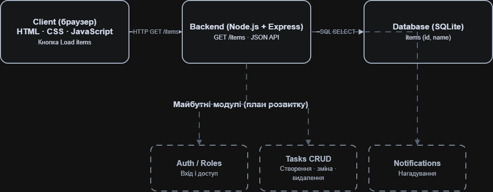
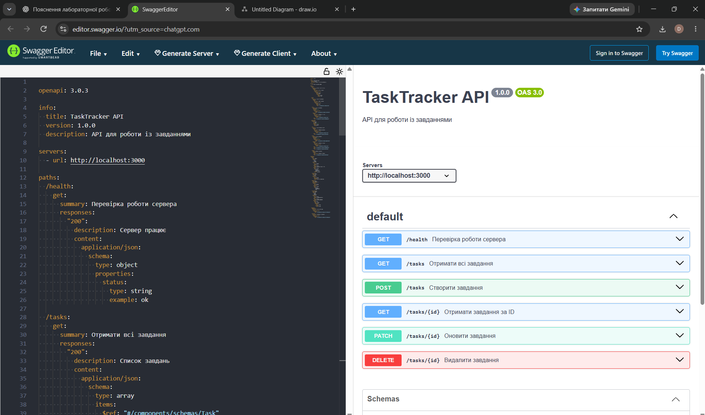

# TaskTracker

Практична робота №1
Базовий клієнт — бекенд — база даних

Студент: Омельчук Максим
Група: ІПЗ-33

## Опис
TaskTracker — навчальний вебзастосунок для
перегляду списку завдань.

## Технології
- HTML, CSS, JavaScript
- Node.js
- Express.js
- SQLite

## Архітектура
Frontend → Backend → SQLite

## Запуск

1. Встановити залежності:
   npm install

2. Запустити сервер:
   node server.js

3. Відкрити у браузері:
   http://localhost:3000

## API
GET /items — повертає список завдань із БД.

## Результат
Реалізовано вебсторінку, сервер і локальну
базу даних. Кнопка Load items отримує
дані через API та відображає їх списком.

## Перевірка практичної №1

Після запуску сервера доступні:

- http://localhost:3000 — вебінтерфейс
- http://localhost:3000/items — API

Кнопка Load items виконує GET-запит
і показує записи з бази даних SQLite.

Архітектура:
Client → Express Backend → SQLite.

## Практична робота №2

Бізнес-документ і архітектура TaskTracker.

- [Бізнес-документ](docs/business_doc.md)
- [Архітектурна діаграма](docs/architecture_diagram.drawio)
- [Roadmap](docs/roadmap.md)
### Архітектурна діаграма TaskTracker

## Практична робота №3 — Domain-Driven Design

Виконано аналіз предметної області TaskTracker.

- [Глосарій термінів](docs/domain/glossary.md)
- [Опис сутностей](docs/domain/entities.md)
- [Контекстна діаграма](docs/domain/context_map.png)
- [Редагована діаграма](docs/domain/context_map.drawio)
- [Моделі JavaScript](domain/models.js)

Реалізовано прототип моделей для роботи із завданнями.

## Практична робота №4

У цій практичній реалізовано CRUD API
для керування завданнями.

### API документація

[OpenAPI специфікація](docs/api/openapi.yaml)

### Архітектурні рішення

- [ADR 0001](docs/adr/0001-architecture-style.md)
- [ADR 0002](docs/adr/0002-layered-architecture.md)
- [ADR 0003](docs/adr/0003-api-style-and-error-model.md)

### Тестування

Команда для запуску тестів:

`node --test test/tasks.test.js`

Результат: 2 тести пройдено, 0 помилок.