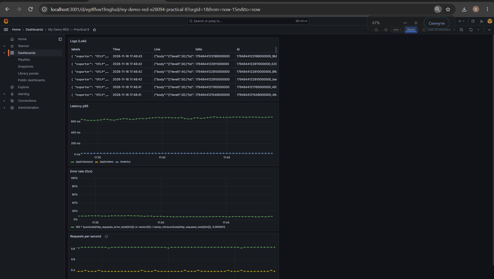

# Практична робота №8
## Observability з Grafana, Loki, Tempo та OpenTelemetry

**Виконав:** Омельчук Максим, ІПЗ-33

### Мета
Ознайомитися з моніторингом вебзастосунків та навчитися працювати з метриками і логами у Grafana.

### Хід роботи

1. Завантажив навчальний проєкт observability-demo.
2. Запустив Docker-контейнери командою docker compose up -d --build.
3. Перевірив роботу сервісів через docker compose ps.
4. Відкрив Grafana та переглянув готовий RED-дашборд.
5. Створив власний дашборд My Demo RED — Practical 8.
6. Додав чотири панелі з даними Prometheus та Loki.
7. Експортував налаштування дашборду у JSON.

### Використані запити

**1. Requests per second**

sum(rate(http_requests_total[1m])) by (route)

Показує середню кількість HTTP-запитів за секунду для кожного маршруту.

**2. Error rate (5xx)**

100 * (sum(rate(http_requests_error_total[5m])) or vector(0)) / clamp_min(sum(rate(http_requests_total[5m])), 0.000001)

Показує частку помилкових запитів у відсотках. Додав обробку відсутніх даних та захист від ділення на нуль.

**3. Latency p95**

histogram_quantile(0.95, sum(rate(http_request_duration_ms_bucket[5m])) by (le, route))

Показує 95-й перцентиль часу відповіді сервера в мілісекундах.

**4. Logs (Loki)**

{service="demo-app"}

Виводить журнали демонстраційного сервісу у вигляді таблиці. За ними можна переглядати події та шукати помилки.

### Результат

Створив власний дашборд із чотирма панелями. Налаштував вибір часового періоду та перевірив, що графіки й таблиця логів отримують дані.

[JSON дашборду](my-demo-red-dashboard.json)

### Висновок

Під час роботи навчився запускати середовище моніторингу через Docker, створювати панелі Grafana та використовувати PromQL і LogQL для перегляду метрик і логів. Зрозумів, як за допомогою цих інструментів можна контролювати роботу сервера.