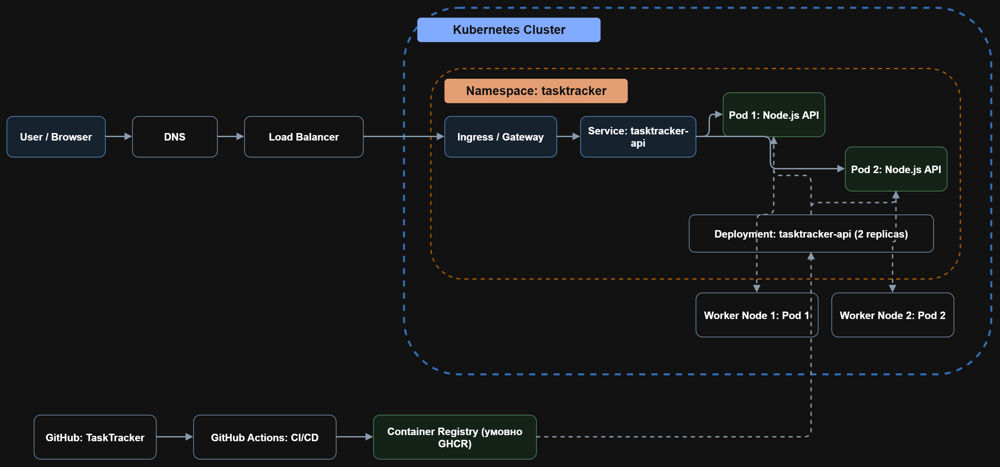

# Практична робота №9
## Теоретична схема Kubernetes-додатку

**Виконав:** Омельчук Максим, ІПЗ-33

### Мета
Ознайомитися з основними компонентами Kubernetes та навчитися проєктувати схему розгортання вебзастосунку.

### Хід роботи
Для схеми я вибрав свій навчальний проєкт TaskTracker, який використовується для роботи із завданнями.

У схемі застосунок розміщено в namespace `tasktracker` усередині Kubernetes Cluster.

Користувач звертається до умовного домену `tasktracker.example.com`, після чого запит проходить через DNS, Load Balancer та Ingress до Service, який передає його одному з Pod-ів.

Я передбачив Deployment із двома репліками Node.js API, щоб підвищити доступність застосунку.

Код зберігається на GitHub, GitHub Actions використовується для CI/CD, а готові Docker-образи передбачено зберігати в Container Registry.

### Схема

[Відкрити файл draw.io](tasktracker-kubernetes.drawio)

### Висновок
Під час роботи я розібрався, для чого потрібні Cluster, Namespace, Deployment, Service та Pod. Навчився показувати шлях HTTP-запиту та процес доставки Docker-образу на архітектурній схемі.

Схема є теоретичною. Реальне розгортання в Kubernetes не виконувалося.